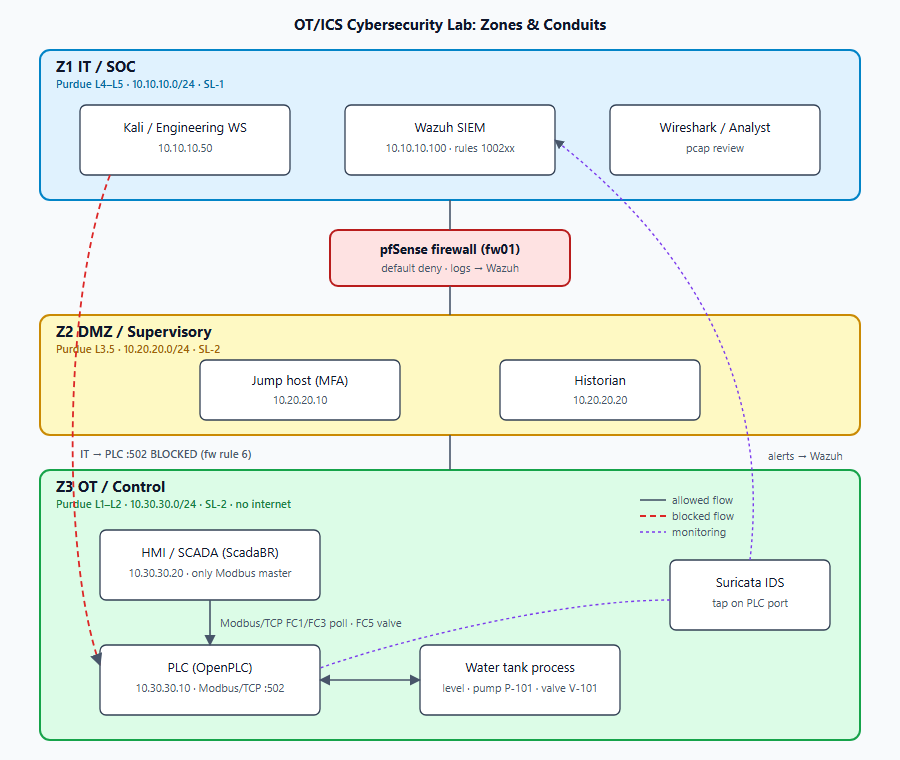
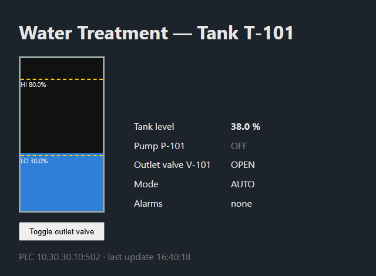

# OT/ICS Cybersecurity Lab: Water Tank Control System

A small but realistic industrial network built to practise **defending an industrial process**: a PLC-controlled water tank supervised by an HMI over Modbus/TCP, segmented from IT by a zone firewall, and monitored by a protocol-aware IDS and a SIEM.

The lab follows the full defender workflow: **normal → anomaly → detection → investigation → mitigation**. It's mapped to **IEC 62443**, the **Purdue Model** and **MITRE ATT&CK for ICS**.



## Highlights
- Working industrial process: water tank level control with hysteresis, a safety interlock and setpoint validation (IEC 61131-3 Structured Text for OpenPLC, plus an identical Python soft PLC with **7 unit tests**)
- Zones and conduits: IT / DMZ / OT, default-deny firewall, no IT→OT Modbus, no OT internet egress
- **13 Suricata rules** built as an allow-list from a captured baseline: **0 false positives** on normal traffic, unauthorised Modbus client detected immediately
- **10 Wazuh rules**, including a level-15 **recon → process-write correlation**, validated with `wazuh-logtest`
- Three documented scenarios with ATT&CK for ICS and IEC 62443 mappings, investigation playbooks and mitigations
- Threat model and a security assessment report with prioritised findings

## Objective
Show why IT and OT are separated, which traffic may cross zones, what happens when an unauthorised workstation talks to a PLC, and which controls reduce that risk, with evidence rather than only screenshots.

## Technologies
| Area | Tools |
|---|---|
| Control | OpenPLC v3 (IEC 61131-3 ST), Python soft PLC (pymodbus) |
| Supervision | ScadaBR, Flask HMI |
| Protocol | Modbus/TCP |
| Network security | pfSense / OPNsense, iptables, ufw |
| Monitoring | Suricata 7 (Modbus app-layer), Wazuh 4.9, Wireshark / tshark, Zeek (optional) |
| Infrastructure | VirtualBox / VMware (full build), Docker Compose (lightweight build) |

## Network design
| Zone | Subnet | Purdue | Assets |
|---|---|---|---|
| IT / SOC | 10.10.10.0/24 | L4–L5 | Kali engineering WS, Wazuh SIEM, analyst workstation |
| DMZ | 10.20.20.0/24 | L3.5 | Jump host (MFA), historian |
| OT | 10.30.30.0/24 | L1–L2 | PLC 10.30.30.10, HMI 10.30.30.20, IDS tap |

Full inventory and communication matrix: [`architecture/ip-addressing.md`](architecture/ip-addressing.md) · Firewall policy: [`firewall/rules.md`](firewall/rules.md)

## Industrial process
```
Tank level sensor ──► PLC ──► Pump P-101
                       │
   level < 30 %  → pump ON
   level > 80 %  → pump OFF
   level ≥ 95 %  → pump forced OFF (interlock, any mode)
                       │
                      HMI  [ Tank: 38.0 % ] [ Pump: OFF ] [ Valve: OPEN ]
```


Modbus map and program: [`plc/water-tank-program/`](plc/water-tank-program/) · HMI configuration: [`scada/`](scada/)

## Threat model
Modbus/TCP has **no authentication and no integrity protection**. Any host that reaches TCP 502 is a valid master. The design therefore layers network segmentation, protocol-aware monitoring and validation inside the controller. Full model: [`docs/threat-model.md`](docs/threat-model.md)

## Detection scenarios
| # | Scenario | ATT&CK for ICS | Result |
|---|---|---|---|
| 01 | [Unauthorised workstation communicates with the PLC](attack-scenarios/scenario-01-unauthorised-plc-access.md) | T0886, T0861 | ✅ Detected (SID 9000001 → Wazuh 100201). ⚠️ PLC still served the read → finding F-01 |
| 02 | [IT host attempts to reach the PLC](attack-scenarios/scenario-02-it-to-ot-pivot.md) | T0886, T0866 | ✅ Blocked and logged by the conduit firewall |
| 03 | [Unauthorised change to process control values](attack-scenarios/scenario-03-process-manipulation.md) | T0855, T0836, T0858 | 📋 Rules and in-PLC safeguards implemented and rule-tested; live run planned for VM build |

## Findings & mitigations
| ID | Finding | Severity | Mitigation |
|---|---|---|---|
| F-01 | PLC serves Modbus to any OT host | High | Host allow-list (HMI only), switch port security / 802.1X |
| F-03 | Modbus lacks auth/integrity | High (accepted) | Segmentation, allow-list IDS, interlock + setpoint validation |
| F-04 | Default credentials on OpenPLC / ScadaBR | Medium | Change and separate operator/engineer roles |
| F-05 | No independent SIS | Medium | Separate safety system in real deployments |
| F-06 | Compromised HMI inherits Modbus access | Medium | Minimal HMI write footprint + write-target rules + correlation |

Full report: [`docs/security-assessment.md`](docs/security-assessment.md) · Evidence: [`detection/evidence/`](detection/evidence/)

## Quick start (Docker build)
```sh
git clone https://github.com/kgiannopoulou/ot-ics-cybersecurity-lab.git
cd ot-ics-cybersecurity-lab
docker compose up -d --build
# HMI:            http://127.0.0.1:8080
# Suricata alerts: logs/suricata/fast.log
python -m pytest tests/      # control-logic unit tests (pip install -r requirements.txt pytest)
```
The full VirtualBox/VMware build with pfSense, OpenPLC, ScadaBR and Wazuh: [`docs/vm-build.md`](docs/vm-build.md)

## Repository layout
```
ot-ics-cybersecurity-lab/
├── architecture/        network diagram, IP addressing & communication matrix
├── plc/                 IEC 61131-3 water tank program (OpenPLC)
├── simulator/           Python soft PLC + process physics (Modbus/TCP server)
├── hmi/                 lightweight web HMI
├── scada/               ScadaBR configuration
├── firewall/            pfSense rule set + iptables conduit policy
├── detection/
│   ├── suricata-rules/  OT Modbus rules + sensor config
│   ├── wazuh/           custom rules, agent config
│   └── evidence/        validation output
├── pcaps/               baseline capture + analysis filters
├── attack-scenarios/    detection scenarios 01–03
├── screenshots/
├── tests/               control-logic unit tests
└── docs/                threat model, security assessment, VM build guide
```

## Standards mapping
| Framework | Where it's applied |
|---|---|
| **IEC 62443-3-2** zones & conduits, SL-T | Zone design, `docs/threat-model.md` |
| **IEC 62443-3-3** SRs (1.1, 2.1, 3.5, 5.1, 5.2, 6.2…) | Control set, scenario docs |
| **Purdue Model** L1–L5 | Network segmentation, diagram |
| **MITRE ATT&CK for ICS** | Every Suricata/Wazuh rule and scenario |

## Ethics
All testing is done only against systems in this isolated lab. Nothing here should be pointed at real industrial equipment.
